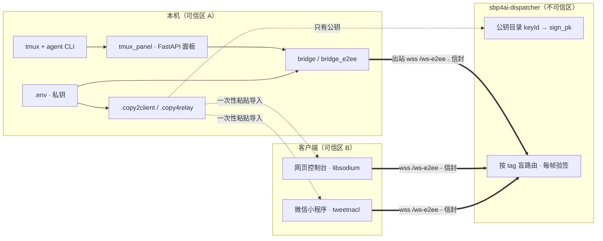

# sbp4ai-agents

SBP (Session Bridge Protocol) 的**设备端**：装在跑 tmux + agent CLI 的那台机器上
（claude-code / codex / dsh / hermes / openclaw / workbuddy / qwen-office）。

它做两件事：

1. 起一个本地面板（FastAPI + 免构建前端），看 tmux 里的会话、历史、实时屏幕、选项卡片；
2. 用**只出站**的 WebSocket 把这些会话上报到中继（sbp4ai-dispatcher），所以本机不需要开任何端口。

## 标准用法（三步）

```bash
pip install sbp4ai-agents
sbp-agents --relay wss://relay.example.com/ws-e2ee   # 首次启动自动生成密钥
cat .copy2client
```

**`cat .copy2client` → 整段复制 → 粘进控制台/小程序的「粘贴导入」框，一次导入两台客户端
（`cli-web` 网页控制台 + `cli-minis` 微信小程序）。**

启动横幅里直接打印 `.env` 与 `.copy2client` 的**绝对路径**，从哪个目录拉起都不会找错文件：

```
  配置文件:  /root/sbp/.env
  连接信息:  /root/sbp/.copy2client
  Ctrl+C 停止
```

## 安装与启动

```bash
pip install sbp4ai-agents
sbp-agents                       # 127.0.0.1:20016 起面板（端口被占会自动 +1）
sbp-agents --host 0.0.0.0        # 局域网访问
sbp-agents --relay wss://relay.example.com/ws-e2ee
```

## 密钥托管：默认随机，可手改

第一次启动时，会在工作目录生成 `.env`（权限 600），里面的密钥**全是随机生成**的：

```dotenv
SBP_E2EE_DID=dev-mac-1a2b        # 设备 id，会话 scope 的前缀
SBP_E2EE_KEY_ID=dev-mac-1a2b     # 在公钥目录里的 keyId
SBP_E2EE_KEY=<box_sk_b64>:<sign_sk_b64>   # 私钥，只在这台机器上
SBP_E2EE_RK=<64-hex>             # 路由密钥（tag = HMAC-SHA256(rk, scope)）
SBP_E2EE_PEERS=cli-web:<box_pk>:<sign_pk>,cli-minis:...   # 允许连进来的客户端公钥
SBP_CLIENT_KEYS=cli-web:<box_sk>:<sign_sk>,cli-minis:...  # 客户端私钥，用于导出
SBP_BRIDGE_E2EE=wss://relay.example.com/ws-e2ee
```

想要用自己的密钥，直接改 `.env` 再重启即可（`box_sk` 32 字节、`sign_sk` 用 libsodium 的
64 字节形态 `seed||pk`，两种都收）。私钥**永远不上中继**。

## .copy2client：一次粘贴导入两台客户端

启动后终端会另起一段打印连接信息，同时写到工作目录的两个文件：

```
.copy2client   每台客户端一行 sbp1.<base64url(json)>（含私钥，别贴到公开地方）
.copy4relay    给 sbp4ai-dispatcher 的 SBP_TRUSTED_KEYS= 一行（只有公钥）
```

在机器上 `cat .copy2client` → 整段复制 → 粘进「粘贴导入」框：

- 网页控制台（地址由部署方提供，可设 `SBP_CONSOLE_URL` 环境变量）→ 服务器管理 → 粘贴导入
- 微信小程序 sbp-minis → 设置 → 粘贴导入

一次导入两台（网页控制台 + 微信小程序），每台自带私钥，中继那边已经登记过对应公钥，
不用再手工填 DID / rk / 公钥。

`.copy4relay` 里那一行只有公钥，可以直接发给中继：

```bash
export SBP_TRUSTED_KEYS="$(sed -n 's/^SBP_TRUSTED_KEYS=//p' .copy4relay)"
sbp-dispatcher     # 中继只拿它验签，解不开任何一帧
```

## 架构



## 相关

- [`sbp4ai-client`](https://pypi.org/project/sbp4ai-client/) — E2EE 加密内核（PyNaCl），两端共用。
- [`sbp4ai-dispatcher`](https://pypi.org/project/sbp4ai-dispatcher/) — 中继，只有公钥目录。
- 协议：[`SBP-0.4-e2ee.md`](https://github.com/sbp4ai/sbp-spec/blob/main/spec/SBP-0.4-e2ee.md)。
